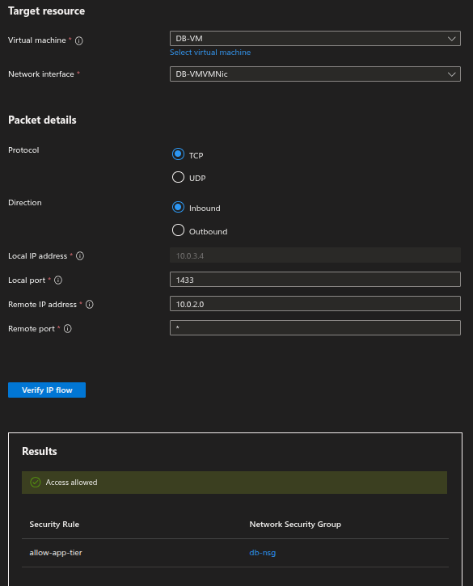
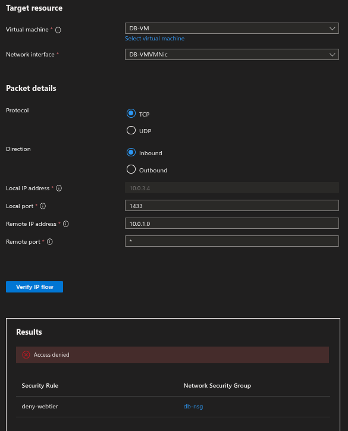
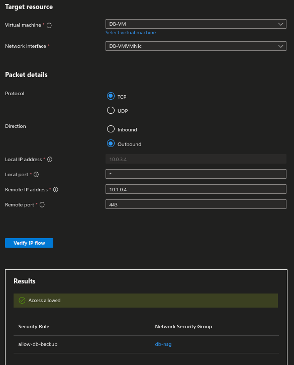
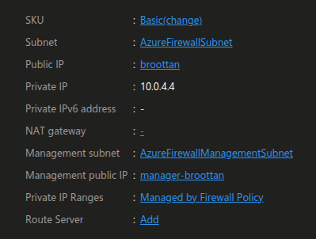
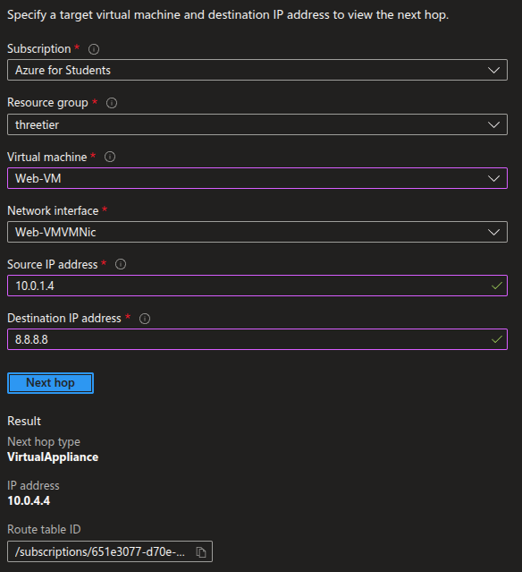
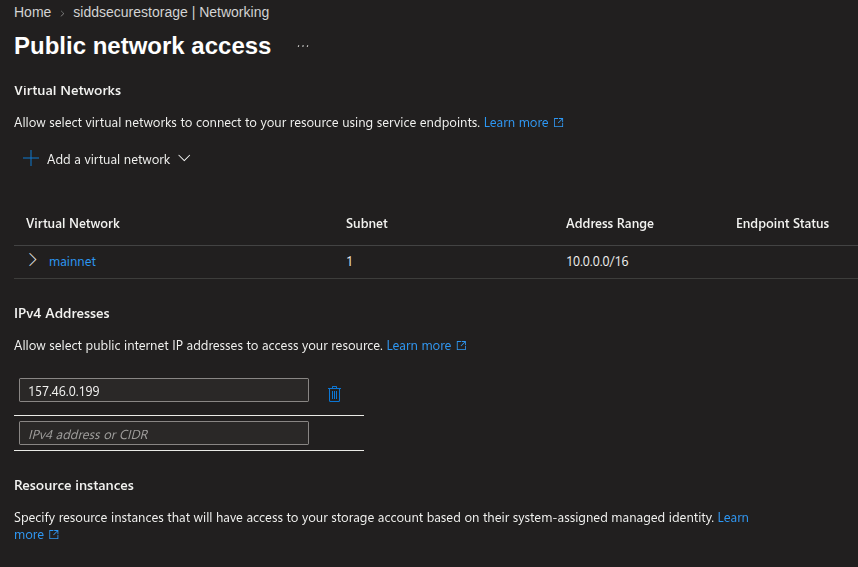

<h1>Secure Three-Tier Azure Architecture: Multi-Region Deployment with Zero Trust Routing</h1>

<h2>Project Overview</h2>

This project demonstrates the design, deployment, and validation of a secure, decoupled three-tier network architecture in Microsoft Azure, spanning multiple regions. By breaking away from default cloud routing behaviors, this environment enforces strict isolation boundaries using Zero Trust principles, custom User Defined Routes (UDRs) via Azure Firewall, and secure Platform-as-a-Service (PaaS) integrations.

This deployment model follows the cloud security principles of Least Privilege and Defense-in-Depth, mimicking enterprise-grade architecture used to shield sensitive data tiers from raw public internet exposure.

🗺️ Network Architecture Design

The infrastructure is built across two peered Virtual Networks (VNets) to simulate a primary site and a disaster recovery site:

**Primary Region (East US) - 10.0.0.0/16:**
*   **Public Subnet (Web-tier - 10.0.1.0/24):** Hosts the frontend web server. This layer accepts public HTTPS traffic and acts as the entry point.
*   **Private Subnet (App-tier - 10.0.2.0/24):** Hosts the backend application logic. Entirely invisible to the internet.
*   **Private Subnet (DB-tier - 10.0.3.0/24):** Hosts the database. Heavily isolated.
*   **AzureFirewallSubnet (10.0.4.0/26):** Dedicated subnet for central egress inspection.

**Disaster Recovery Region (West US) - 10.1.0.0/16:**
*   **Private Subnet (DR-tier - 10.1.1.0/24):** Connected via Global VNet Peering to pull secure backups from the primary DB-tier.

🛠️ Technical Components & Specs

*   **Cloud Provider:** Microsoft Azure
*   **Networking:** Global VNet Peering, Route Tables (UDR), Network Security Groups (NSGs).
*   **Security:** Azure Firewall, Service Endpoints, System-Assigned Managed Identities.
*   **Diagnostic Tools:** Azure Network Watcher (IP Flow Verify & Next Hop).

🛡️ Firewall Configuration & Traffic Rules

To override Azure's standard, overly permissive lateral routing (`AllowVnetInbound`), custom stateful firewall rule matrices were implemented using a default-deny (Priority 110) approach.

> **Frontend to Middleware (Web-to-App)**
The App-tier strictly allows inbound traffic from the Web-tier on port 8080.

> **Middleware to Backend (App-to-DB)**
The DB-tier explicitly allows the App-tier (1433) while implicitly/explicitly dropping Web-tier traffic.

> **Cross-Region Disaster Recovery**
The DB-tier allows inbound connections from the peered backup subnet for secure data replication.

🔥 Custom Routing (Egress Control)

Instead of allowing default outbound internet access, a **Route Table** was attached to the Web-tier. All `0.0.0.0/0` traffic is forced to the Private IP of an **Azure Firewall** (`10.0.4.4`) deployed in a dedicated subnet. Network Watcher's Next Hop confirms the traffic successfully routes to the Virtual Appliance.

📦 PaaS Security & Identity Lockdown

To securely connect the App-tier to Azure Storage without traversing the public internet:
1.  **Service Endpoints (`Microsoft.Storage`)** were enabled on the App-tier subnet.
2.  The Storage Account's public firewall was restricted to only accept traffic from the App-tier subnet (and a local IP for testing).
3.  A **System-Assigned Managed Identity** was enabled on the App-VM, granting it RBAC permissions (`Storage Blob Data Contributor`) to read/write data without hardcoded credentials.

🚀 Deployment Steps & Hands-on Validation

*   **Phase 1: Provisioning the Network Matrix:** Created the Main and Backup VNets, carved out subnets, and established a two-way Global VNet Peering bridge.
*   **Phase 2: Zero Trust NSGs:** Built and attached NSGs exclusively at the Subnet level (removing default NIC NSGs) to enforce strict Priority 100 Allow / Priority 110 Deny rules.
*   **Phase 3: Egress & PaaS:** Deployed Azure Firewall, configured UDRs, and locked down Azure Storage with Service Endpoints.
*   **Phase 4: Validation:** Utilized Network Watcher's **IP Flow Verify** to simulate TCP handshakes across tiers, proving the stateful rules successfully allowed authorized traffic and dropped unauthorized lateral movement.

 
<h3>Learned the following : </h3>

*   **Advanced Routing:** Implementing User Defined Routes (UDRs) and Azure Firewall.
*   **Global Peering:** Bridging networks across distinct Azure regions.
*   **Zero Trust Security:** Engineering strict NSG rulesets and overriding default VNet behaviors.
*   **PaaS Isolation:** Securing Storage Accounts with Service Endpoints and Managed Identities.
*   **Network Diagnostics:** Validating architecture using Azure Network Watcher.
